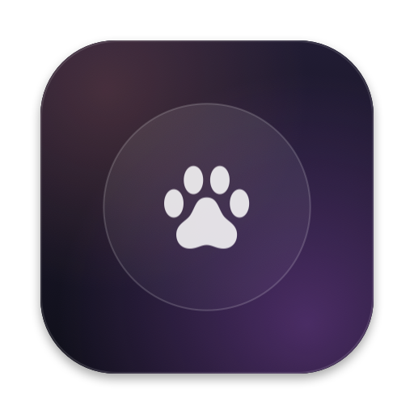
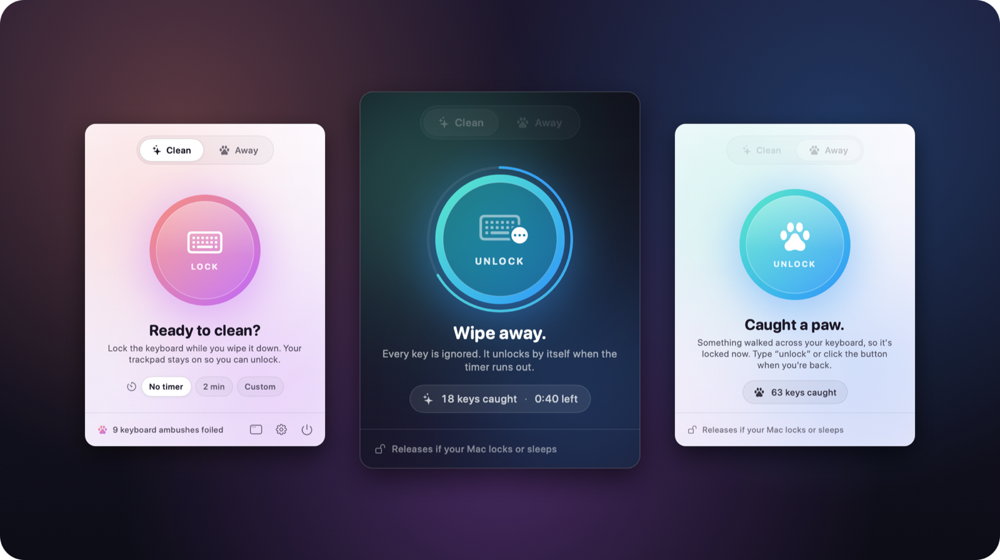
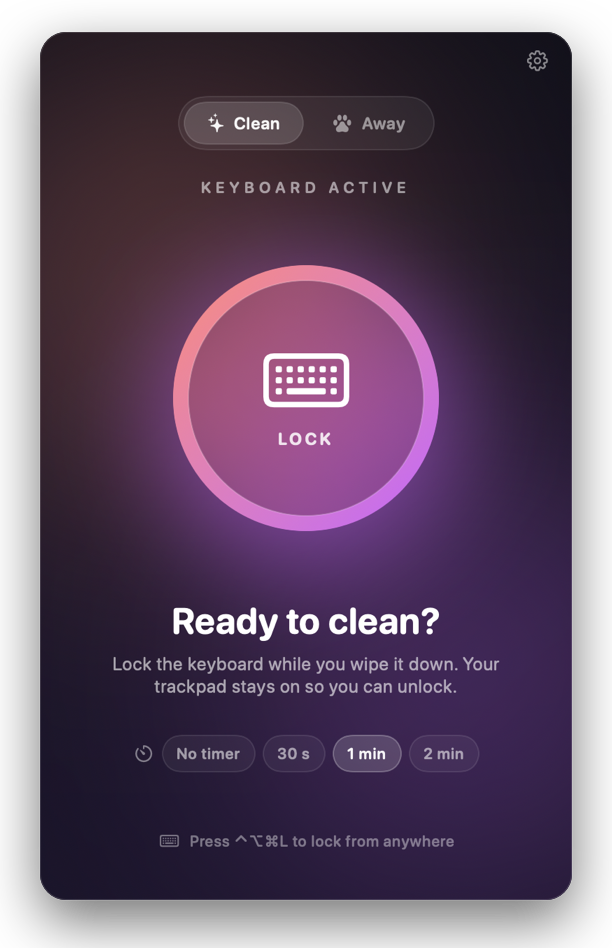
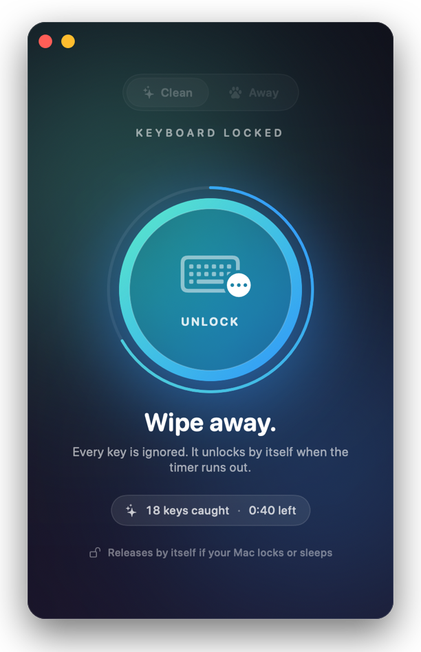
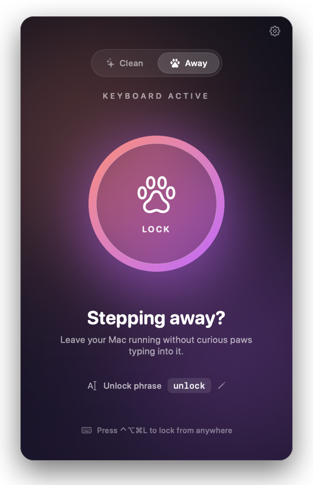
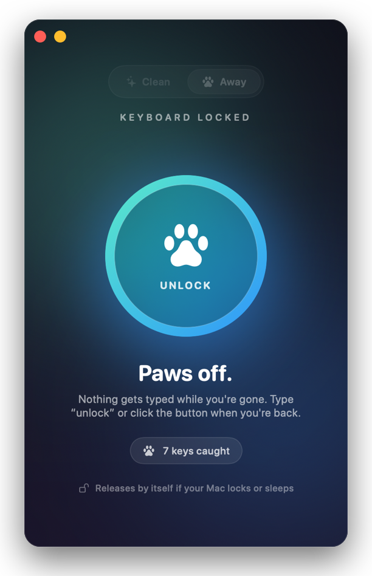
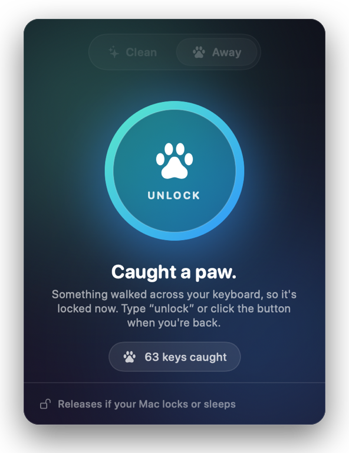
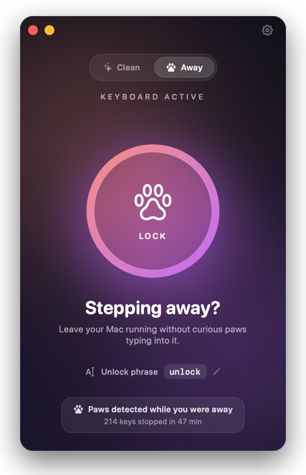
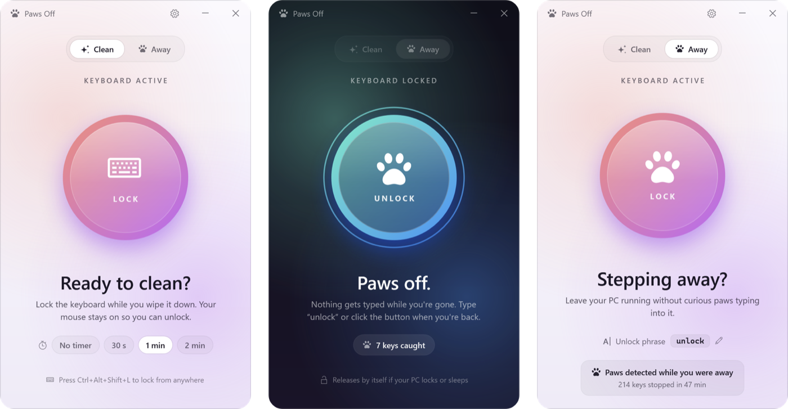

<div align="center">



# Paws Off

**Pause your keyboard with one click.**<br>
Wipe it down without typing gibberish — or step away without your cat writing your emails.

<a href="https://github.com/EnigmaticZee/PawsOff/releases/latest/download/PawsOff-mac.dmg"></a>
&nbsp;
<a href="https://github.com/EnigmaticZee/PawsOff/releases/latest/download/PawsOff-Windows.exe"></a>

<sub>Free · macOS 14+ (Apple Silicon & Intel) · Windows 10 & 11</sub>

<br>

[](https://github.com/EnigmaticZee/PawsOff/releases)

[](LICENSE)

[Features](#-features) · [Install](#-install) · [How it works](#-how-it-works) · [FAQ](#-faq) · [Development](#%EF%B8%8F-development)

<br>



</div>

<br>

## ✨ Features

<table>
<tr>
<td width="50%" valign="top">

### 🧽 Clean mode
For wiping down your keyboard.

- **One click** and every key is ignored, including modifiers and media keys.
- **Auto-unlock timer:** 30 s, 1 min or 2 min, with a countdown ring.
- **Your trackpad and mouse keep working**, so you can always click **Unlock**.

</td>
<td width="50%" valign="top">

### 🐾 Away mode
For leaving your computer running near curious pets.

- **Unlock phrase:** type `unlock` (or your own word) to release it. Pets can't spell.
- **Welcome-back summary:** *"Paws detected while you were away · 214 keys stopped in 47 min."*
- Downloads, renders and calls **keep running**. No need to lock the screen.

</td>
</tr>
</table>

| | |
| --- | --- |
| 🐈 **Paw detection** | Locks on its own when a cat walks or sits on the keyboard (4+ keys held at once, or 2+ held for 3 seconds). |
| ⌨️ **Global shortcut** | Lock or unlock from any app: <kbd>⌃</kbd><kbd>⌥</kbd><kbd>⌘</kbd><kbd>L</kbd> on Mac, <kbd>Ctrl</kbd><kbd>Alt</kbd><kbd>Shift</kbd><kbd>L</kbd> on Windows. |
| 🐾 **Menu bar / tray paw** | Lock, unlock or open Paws Off, even with the window closed. |
| 🌗 **Light & dark** | Follows your system appearance automatically; pick Light or Dark in ⚙️ Settings on Windows. |
| 🚀 **Launch at login** | Keeps the shortcut and paw detection ready. Turn it on in ⚙️ Settings, along with your unlock phrase. |
| 🔓 **Never locks you out** | The keyboard is released the moment your computer locks, sleeps, switches user or shuts down, so you can always type your password. |

<details>
<summary><b>📸 More screenshots</b></summary>
<br>

<table>
<tr>
<td align="center" width="33%"><br><sub><b>Ready to clean</b></sub></td>
<td align="center" width="33%"><br><sub><b>Wiping away</b></sub></td>
<td align="center" width="33%"><br><sub><b>Stepping away</b></sub></td>
</tr>
<tr>
<td align="center"><br><sub><b>Paws off</b></sub></td>
<td align="center"><br><sub><b>Caught a paw</b></sub></td>
<td align="center"><br><sub><b>Welcome back</b></sub></td>
</tr>
</table>


<p align="center"><sub><b>On Windows</b>, in light and dark</sub></p>

</details>

<br>

## 📦 Install

Paws Off isn't signed with a paid Apple or Microsoft developer certificate yet, so both systems ask you to confirm the first time you open it. It's open source: you can read every line, or [build it yourself](#%EF%B8%8F-development).

### 🍎 Mac

1. **[Download PawsOff-mac.dmg](https://github.com/EnigmaticZee/PawsOff/releases/latest/download/PawsOff-mac.dmg)**, open it, and drag **Paws Off** into **Applications**.
2. **Open it once.** Double-click **Paws Off** in Applications. macOS says *"Paws Off" Not Opened* (or *can't be opened because Apple cannot check it*). Click **Done**.
3. **Allow it.** Open **System Settings → Privacy & Security**, scroll down to **Security**, and next to *"Paws Off" was blocked* click **Open Anyway**. Enter your password, then click **Open Anyway** again.
4. **Give it keyboard access.** In Paws Off, click **Grant Access**, then switch on **Paws Off** in **System Settings → Privacy & Security → Accessibility**. The button changes to **Lock**.

<details>
<summary>Prefer Terminal? Skip steps 2–3 with one command</summary>
<br>

This removes the "downloaded from the internet" flag that macOS checks, for this app only:

```sh
xattr -dr com.apple.quarantine "/Applications/Paws Off.app"
```

</details>

<details>
<summary>The Accessibility switch is on, but nothing gets locked</summary>
<br>

Click **Already switched on? Reset and ask again** in Paws Off. This clears an old permission, for example one left by an earlier version, and asks again.

</details>

### 🪟 Windows

1. **[Download PawsOff-Windows.exe](https://github.com/EnigmaticZee/PawsOff/releases/latest/download/PawsOff-Windows.exe)** and move it somewhere permanent, for example `Documents\PawsOff`. There's nothing to install, and it doesn't need admin rights.
2. Open it. If SmartScreen says *"Windows protected your PC"*, click **More info → Run anyway**.
3. Paws Off appears with a paw in the system tray. Closing the window keeps it running there.

<br>

## 🔍 How it works

```
 keyboard ──▶ Paws Off keyboard hook ──▶ unlocked? ──yes──▶ your apps
                      │                     │
                      │                     no ──▶ swallowed (counted, checked for unlock phrase)
                      │
                      └──▶ watching for the shortcut and paw patterns
```

- **Mac:** a session event tap (`CGEventTap`). **Windows:** a low-level keyboard hook (`WH_KEYBOARD_LL`). Both see key presses before any app does: passed straight through while unlocked, dropped while locked.
- **Paw detection** only looks at *how many keys are held and for how long*, never at what you type, and never fires while the screen is locked.
- **No network access.** Paws Off never connects to the internet.
- **Nothing you type is stored or logged.** While locked it keeps only the last few characters, enough to spot your unlock phrase, and discards them on unlock.

<br>

## ❓ FAQ

<details>
<summary><b>Why does the Mac version need Accessibility access?</b></summary>
<br>
macOS only lets apps with Accessibility access intercept keystrokes. Paws Off uses it only to drop key presses while locked and to notice the shortcut and paw patterns. Windows needs no permission.
</details>

<details>
<summary><b>Can it block the Touch ID / power button, or Ctrl+Alt+Delete?</b></summary>
<br>
No. The system handles those keys itself. If one is pressed, your computer locks and Paws Off releases the keyboard.
</details>

<details>
<summary><b>Paw detection triggered while I was gaming or typing fast.</b></summary>
<br>
Holding four or more letter keys at once looks like a paw. Turn <b>Paw detection</b> off in ⚙️ Settings. Locking by hand keeps working.
</details>

<details>
<summary><b>On Windows, some keys still reach an app running as administrator.</b></summary>
<br>
Windows doesn't let normal apps block input to apps running with admin rights. Everything else is blocked as usual.
</details>

<br>

## 🗺️ Roadmap

- [ ] Screen-cleaning mode: a black fullscreen that shows smudges, with trackpad clicks paused
- [ ] Key tester to check every key after cleaning
- [ ] Custom global shortcut
- [ ] Signed and notarized builds, so there's no first-launch prompt
- [ ] Lifetime stats: *"1,203 paw presses blocked"*

<br>

## 🛠️ Development

```sh
git clone https://github.com/EnigmaticZee/PawsOff.git && cd PawsOff

# Mac (needs the Xcode command line tools: xcode-select --install)
./build.sh && open "Paws Off.app"   # build and run
Tools/make-dmg.sh                    # universal app + dist/PawsOff-mac.dmg
Tools/make-readme-art.sh             # refresh the images in this README

# Windows (needs the .NET SDK, run on Windows)
dotnet publish windows/PawsOff.csproj -c Release -o out
```

| Path | What |
| --- | --- |
| `Sources/` | Mac app (SwiftUI). `KeyboardBlocker.swift` holds the event tap and all lock logic. |
| `windows/` | Windows app (WPF, .NET Framework 4.8). `KeyboardBlocker.cs` holds the hook and all lock logic. |
| `.github/workflows/build.yml` | Builds both apps on every push; publishes a Release when a `v*` tag is pushed. |
| `Tools/` | Icon, Windows icon, DMG and README art generators. |
| [`docs/DEVELOPMENT.md`](docs/DEVELOPMENT.md) | **Rules to read before changing code.** |
| [`docs/HISTORY.md`](docs/HISTORY.md) | Version history. |

**Releasing:** `./build.sh <version>`, add the version to `docs/HISTORY.md`, commit, then `git tag v<version> && git push --follow-tags`. GitHub Actions builds both apps and publishes the downloads.

**Contributing:** issues and pull requests are welcome. The one rule that matters most: **there must always be a way to unlock.**

<br>

---

<div align="center">

Made with 🐾 by **Zaid** · [MIT License](LICENSE)

</div>
