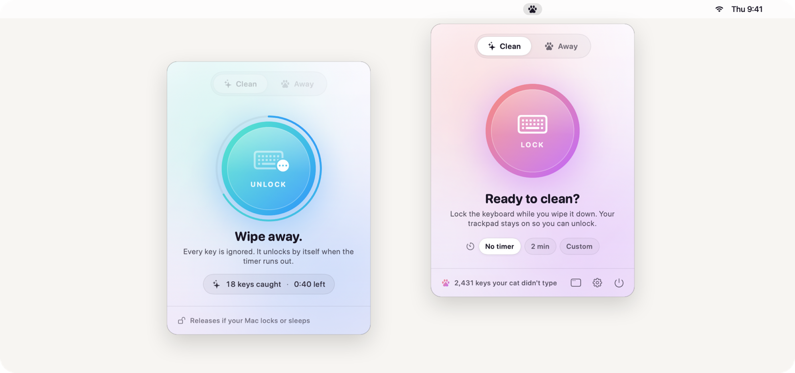
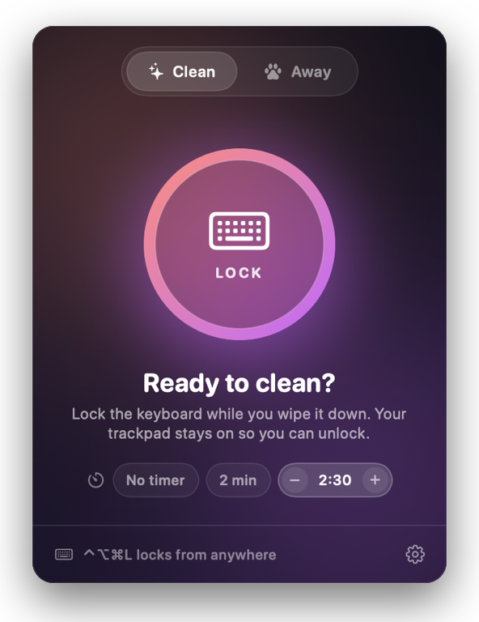
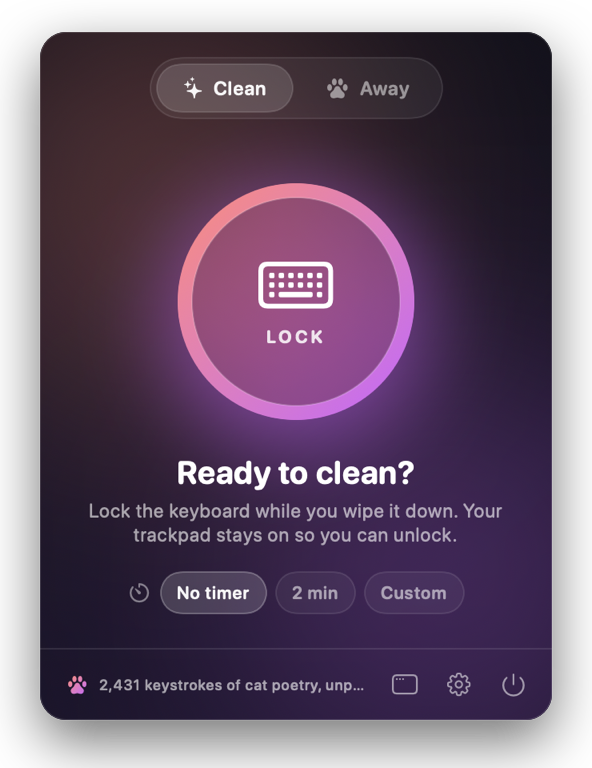
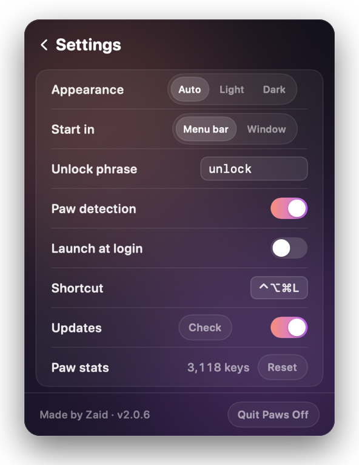

<div align="center">


# Paws Off

**Pause your keyboard with one click.**<br>
Wipe it down without typing gibberish — or step away without your cat writing your emails.

<a href="https://github.com/EnigmaticZee/PawsOff/releases/latest/download/PawsOff-mac.dmg"></a>
&nbsp;
<a href="https://github.com/EnigmaticZee/PawsOff/releases/latest/download/PawsOff-Windows-Setup.exe"></a>

<sub>Free · macOS 14+ (Apple Silicon & Intel) · Windows 10 & 11</sub><br>
<sub>Homebrew: <code>brew install --cask enigmaticzee/tap/paws-off</code></sub>

<br>

[](https://github.com/EnigmaticZee/PawsOff/releases)

[](LICENSE)

[Website](https://enigmaticzee.github.io/PawsOff/) · [Features](#-features) · [Install](#-install) · [How it works](#-how-it-works) · [FAQ](#-faq) · [Development](#%EF%B8%8F-development)

<br>

<picture>
  <source media="(prefers-color-scheme: dark)" srcset="docs/images/hero-dark.png">
  
</picture>

</div>

<br>

## ✨ Features

<table>
<tr>
<td width="50%" valign="top">

### 🧽 Clean mode
For wiping down your keyboard.

- **One click** and every key is ignored, including modifiers and media keys.
- **Auto-unlock timer:** 2 min, or any length you type in (from 2:01), with a countdown ring.
- **Your trackpad and mouse keep working**, so you can always click **Unlock**.

</td>
<td width="50%" valign="top">

### 🐾 Away mode
For leaving your computer running near curious pets.

- **Unlock phrase:** type `unlock` (or your own word) to release it. Pets can't spell.
- **Paw detection** locks on its own when a cat walks or sits on the keyboard.
- Downloads, renders and calls **keep running**. No need to lock the screen.

</td>
</tr>
</table>

| | |
| --- | --- |
| 🐾 **Lives in your menu bar / tray** | Click the paw for the panel; right-click for quick actions (lock for cleaning, lock while away, unlock, quit). Prefer a window? Choose **Start in → Window** in Settings. |
| ⌨️ **Global shortcut** | Lock or unlock from any app: <kbd>⌃</kbd><kbd>⌥</kbd><kbd>⌘</kbd><kbd>L</kbd> on Mac, <kbd>Ctrl</kbd><kbd>Alt</kbd><kbd>Shift</kbd><kbd>L</kbd> on Windows. |
| 📊 **Your paw stats** | Lifetime totals, kept only on your computer, shown as rotating one-liners like *"≈ 486 words by paws, never sent"*. |
| 🔓 **Never locks you out** | The keyboard is released the moment your computer locks, sleeps, switches user or shuts down, so you can always type your password. |
| 🌗 **Light and dark** | Follows your system (Auto), or pick Light or Dark in ⚙️ Settings. |
| 🔄 **Stays up to date** | Checks for a new version when it starts and about once a day, installs it on its own (never while your keyboard is locked) and tells you when it has. Turn it off in Settings. |

<details>
<summary><b>📸 More screenshots</b></summary>
<br>

<table>
<tr>
<td align="center" width="33%"><br><sub><b>Ready to clean</b></sub></td>
<td align="center" width="33%"><br><sub><b>Custom timer</b></sub></td>
<td align="center" width="33%"><br><sub><b>Paws off</b></sub></td>
</tr>
<tr>
<td align="center"><br><sub><b>Caught a paw</b></sub></td>
<td align="center"><br><sub><b>Menu bar panel</b></sub></td>
<td align="center"><br><sub><b>Settings</b></sub></td>
</tr>
</table>


<p align="center"><sub><b>On Windows</b>: the window and the tray pop-up</sub></p>

</details>

<br>

## 📦 Install

### ⚡ Quickest: one line

**Mac** (paste into Terminal):

```sh
curl -fsSL https://enigmaticzee.github.io/PawsOff/install.sh | bash
```

**Windows** (paste into PowerShell):

```powershell
irm https://enigmaticzee.github.io/PawsOff/install.ps1 | iex
```

Each downloads the latest release from this page, installs it (just for you, no admin rights on Windows) and opens Paws Off, without the security prompts below. Curious what they do? Read [`install.sh`](site/install.sh) and [`install.ps1`](site/install.ps1); they're short. On a Mac, click **Grant Access** once to let it pause your keyboard.

Paws Off isn't signed with a paid Apple or Microsoft developer certificate yet, so if you download it the usual way, both systems ask you to confirm the first time you open it. It's open source: you can read every line, or [build it yourself](#%EF%B8%8F-development).

### 🍎 Mac

1. **[Download PawsOff-mac.dmg](https://github.com/EnigmaticZee/PawsOff/releases/latest/download/PawsOff-mac.dmg)**, open it, and drag **Paws Off** into **Applications**. (Using Homebrew? See [below](#-homebrew).)
2. **Open it once.** Double-click **Paws Off** in Applications. macOS says *"Paws Off" Not Opened*. Click **Done**.
3. **Allow it.** Open **System Settings → Privacy & Security**, scroll down to **Security**, and next to *"Paws Off" was blocked* click **Open Anyway**. Enter your password, then click **Open Anyway** again.
4. **Give it keyboard access.** In Paws Off, click **Grant Access**, then switch on **Paws Off** in **System Settings → Privacy & Security → Accessibility**.

From then on Paws Off starts in your menu bar: look for the 🐾 at the top of your screen.

<details>
<summary>Prefer Terminal? Skip steps 2–3 with one command</summary>
<br>

This removes the "downloaded from the internet" flag that macOS checks, for this app only:

```sh
xattr -dr com.apple.quarantine "/Applications/Paws Off.app"
```

</details>

<details>
<summary>The Accessibility switch is on, but nothing gets locked</summary>
<br>

Open the Paws Off window and click **Already switched on? Reset and ask again**. This clears a stuck permission (it can happen after moving or reinstalling the app) and asks again.

</details>

### 🍺 Homebrew

Prefer the Terminal? Install with [Homebrew](https://brew.sh):

```sh
brew install --cask enigmaticzee/tap/paws-off
```

Then do steps 2–4 above once: open the app, click **Open Anyway**, and give it keyboard access. (The Terminal shortcut in the box above works here too.)

- **Updates:** Paws Off updates itself, so there's nothing to run. (`brew upgrade` skips it on purpose.)
- **Uninstall:** `brew uninstall --cask paws-off`. Add `--zap` to remove its settings too.

### 🪟 Windows

1. **[Download PawsOff-Windows-Setup.exe](https://github.com/EnigmaticZee/PawsOff/releases/latest/download/PawsOff-Windows-Setup.exe)** and open it. If SmartScreen says *"Windows protected your PC"*, click **More info → Run anyway**.
2. Click through the short setup. It installs just for you (no admin rights) and can add a desktop shortcut or start Paws Off when you sign in.
3. Paws Off lives in the system tray, by the clock: click the 🐾 for the panel. Uninstall any time from **Settings → Apps**.

<br>

## 🔍 How it works

```
 keyboard ──▶ Paws Off keyboard hook ──▶ unlocked? ──yes──▶ your apps
                      │                     │
                      │                     no ──▶ swallowed (counted, checked for unlock phrase)
                      │
                      └──▶ watching for the shortcut and paw patterns
```

- **Mac:** a session event tap (`CGEventTap`). **Windows:** a low-level keyboard hook (`WH_KEYBOARD_LL`). Both see key presses before any app does: passed straight through while unlocked, dropped while locked.
- **Paw detection** only looks at *how many keys are held and for how long*, never at what you type, and never fires while the screen is locked.
- **Nothing you type is stored or sent.** While locked it keeps only the last few characters, enough to spot your unlock phrase, and discards them on unlock. Paw stats are counts only, kept on your computer.
- **The only network request is the update check:** when it starts and about once a day it asks GitHub whether there's a newer release. Turn it off in Settings.

<br>

## ❓ FAQ

<details>
<summary><b>Is this a keylogger?</b></summary>
<br>
No. It has to see key presses to block them, but it never records what you type: while locked it keeps only the last few characters, just enough to spot your unlock phrase, and forgets them on unlock. It sends nothing anywhere except the update check. It's open source, so you can read every line; see <a href="#-how-it-works">How it works</a> and <a href="SECURITY.md">SECURITY.md</a>.
</details>

<details>
<summary><b>Why does macOS say "Paws Off" can't be opened?</b></summary>
<br>
Paws Off isn't notarized by Apple yet (that needs a paid developer account, and it's on the way). macOS asks you to confirm any app like that once: <b>System Settings → Privacy & Security → Open Anyway</b>. Or install with the <a href="#-quickest-one-line">one-line installer</a>, which skips the prompt.
</details>

<details>
<summary><b>Why does the Mac version need Accessibility access?</b></summary>
<br>
macOS only lets apps with Accessibility access intercept keystrokes. Paws Off uses it only to drop key presses while locked and to notice the shortcut and paw patterns. Windows needs no permission.
</details>

<details>
<summary><b>Can it block the Touch ID / power button, or Ctrl+Alt+Delete?</b></summary>
<br>
No. The system handles those keys itself. If one is pressed, your computer locks and Paws Off releases the keyboard.
</details>

<details>
<summary><b>Can paw detection go off while I'm gaming or typing fast?</b></summary>
<br>
It can: holding four or more letter keys at once looks like a paw. If that's you, turn <b>Paw detection</b> off in ⚙️ Settings. Locking by hand keeps working.
</details>

<details>
<summary><b>On Windows, some keys still reach an app running as administrator.</b></summary>
<br>
Windows doesn't let normal apps block input to apps running with admin rights. Everything else is blocked as usual.
</details>

<br>

## 🗺️ Roadmap

- [ ] Screen-cleaning mode: a black fullscreen that shows smudges, with trackpad clicks paused
- [ ] Key tester to check every key after cleaning
- [ ] Custom global shortcut
- [ ] Signed and notarized builds, so there's no first-launch prompt
- [ ] `winget install EnigmaticZee.PawsOff`

<br>

## 🛠️ Development

```sh
git clone https://github.com/EnigmaticZee/PawsOff.git && cd PawsOff

# Mac (needs the Xcode command line tools: xcode-select --install)
./build.sh && open "Paws Off.app"   # build and run
Tools/make-dmg.sh                    # universal app + dist/PawsOff-mac.dmg (needs: pip install dmgbuild)
Tools/make-icons.sh                  # redraw the app icon everywhere (Mac, Windows, installers, README)
Tools/make-readme-art.sh             # refresh the screenshots in this README

# Windows (needs the .NET SDK, run on Windows)
dotnet publish windows/PawsOff.csproj -c Release -o out
```

| Path | What |
| --- | --- |
| `Sources/` | Mac app (SwiftUI + AppKit). `KeyboardBlocker.swift` holds the event tap and all lock logic; `CardView.swift` is the UI shown in the window and the menu bar panel. |
| `windows/` | Windows app (WPF, .NET Framework 4.8). `KeyboardBlocker.cs` holds the hook; `CardView.xaml` is the UI shown in the window and the tray pop-up. |
| `Vendor/Sparkle/` | [Sparkle](https://sparkle-project.org) 2.10.0, the Mac updater (MIT). |
| `.github/workflows/build.yml` | Builds both apps on every push; publishes a Release (with the Sparkle appcast) when a `v*` tag is pushed. |
| `packaging/winget/`, `Tools/winget-submit.sh` | winget manifests and the script that submits a release. Homebrew: [EnigmaticZee/homebrew-tap](https://github.com/EnigmaticZee/homebrew-tap). |
| `Tools/` | Icon, installer art, DMG, README art and in-app release notes generators. |
| `site/` | The website and the one-line installers, published to GitHub Pages (`.github/workflows/site.yml`); `installers.yml` tests the installers on clean machines weekly. |
| [`docs/TESTING.md`](docs/TESTING.md) | The hand-testing checklist for releases. |
| [`docs/DEVELOPMENT.md`](docs/DEVELOPMENT.md) | **Rules to read before changing code.** |
| [`docs/HISTORY.md`](docs/HISTORY.md) | Version history. |

**Releasing:** `./build.sh <version>`, add the version to `docs/HISTORY.md`, commit, then `git tag v<version> && git push --follow-tags`. GitHub Actions builds both apps, signs the Mac update and publishes the downloads. Then run `Tools/winget-submit.sh <version>`.

**Contributing:** issues and pull requests are welcome. The one rule that matters most: **there must always be a way to unlock.**

<br>

---

<div align="center">

Made with 🐾 by **Zaid** · [MIT License](LICENSE)<br>
<sub>Windows app font: [Nunito](https://github.com/googlefonts/nunito) by the Nunito Project Authors, [SIL Open Font License](windows/Fonts/OFL.txt) · Updates by [Sparkle](https://sparkle-project.org)</sub>

</div>
